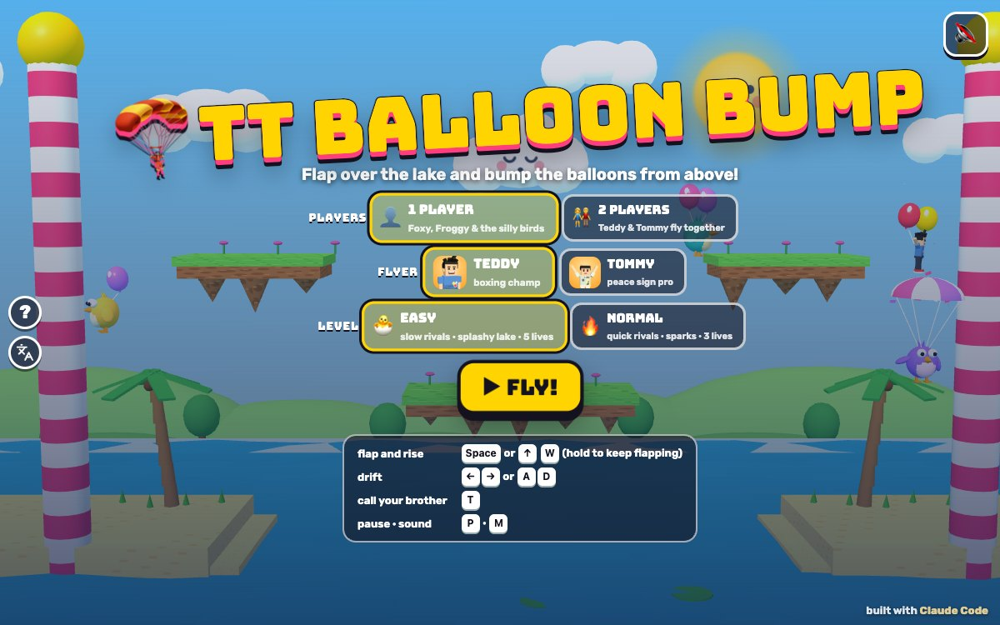

# TT Balloon Bump

Press **?** any time (or tap the round **?** button on the left edge) to see the keys. The game waits while you look.
Tap the language button under it (the A文 icon) to switch between English and 中文; the dashboard and every game remember the choice.

A floaty arcade game over a sunny lake, starring Teddy and Tommy. Each flyer has two balloons on his back: flap to rise, drift left and right, and come down on a rival's balloons from above to pop them. Pop both and the rival opens a striped parachute, floats down into the lake and swims away in a rubber ring, waving. The rivals are 🦊 Foxy, 🐸 Froggy and a flock of silly birds. Giggly sparks bounce around the sky, a big goofy fish jumps up when you fly too low, and every fourth wave is a bonus stage full of rising balloons. The sky wraps: fly behind one candy pole and you come out of the other.

**中文：** 气球碰碰：背着两个气球在湖上飞！扇一下往上飞，左右飘，从上面落到对手的气球上就能戳破它。两个气球都破了，对手就打开降落伞，掉进湖里，套着游泳圈挥手游走。对手有 Foxy、Froggy 和一群傻傻的小鸟。天上有咯咯笑的火花，飞得太低大鱼会跳出来，每第四关是奖励关。天空是连着的：从一边飞出去，会从另一边飞回来。

A 3D game for the boys, built with Claude Code from plain JavaScript and Three.js on the shared Claude Games kit. The flyers are the kit's blocky Teddy and Tommy; Foxy and Froggy are built on the kit's bear (copied from TT Barrel Climb); the birds, the fish and everything else are our own. There are no image, model or audio files: every texture is painted on a canvas and every sound is synthesised. The name, the characters, the art and the sounds are our own. Nobody gets hurt: balloons go pop, riders float down by parachute and swim off, the fish only boops, and sparks tickle.

## Play

- **Double-click `index.html`.** It works offline because Three.js and the kit are copied into `kit/`. Without internet the title font falls back to Arial Black.
- **Send one file:** `dist/balloon-bump-tt.html` is the whole game in one page, about 835 KB. AirDrop or email it, then open it in a browser.
- Rebuild that file after any edit: `python3 kit/tools/bundle.py . --name balloon-bump-tt`

On the title screen pick **1 PLAYER** (then the flyer: Teddy or Tommy) or **2 PLAYERS** (then **CO-OP** or **VERSUS**), the level, and press **▶ FLY!** Behind the menu the autopilot plays a demo.

**Levels:**

- **🐣 EASY** (the default, for Tommy, 5): the rivals flap slower and drift slower, 5 lives, and the lake is friendly: touch the water and the big fish splashes you back up into the sky. Sparks only come from wave 3, one at a time, slowly, and they just tickle you.
- **🔥 NORMAL** (for Teddy, 8): quicker rivals, 3 lives, sparks from wave 2 (two at once) that pop a balloon, the fish boops a balloon if you hang low over the water, and falling into the lake costs a life.

An extra life comes every 20,000 points. Each time round the eight waves, the rivals get a little quicker.

## The waves

1. Three silly birds. 2. Two birds and Foxy. 3. Foxy, Froggy and a bird. 4. **BONUS STAGE.** 5. Two birds, Foxy and Froggy. 6. The same four on new islands. 7. Five rivals. 8. **BONUS STAGE.** Then round again, a little faster. There are four island layouts.

- **Each wave** starts with the rivals standing on the islands pumping up their balloons (you can pop them while they pump!). The wave ends the moment every rival is down: **WAVE CLEAR!**, your flyer does his signature move, confetti, and the next wave.
- **Bumps:** come down on a balloon from above (your feet at least 0.7 m higher) and it pops. Side by side, you just bounce apart. If a rival comes down on you, you lose a balloon; with one balloon you fly a bit heavier; with none you parachute down, swim off waving, lose a life and come back on your shore with two new balloons (blinking, safe for a moment).
- **Points:** pop a balloon 500, a rider parachuting 1,000 more, a bonus balloon 300, all 20 bonus balloons **PERFECT!** +5,000, your brother's treat 100.
- **Sparks** come out of the sleepy cloud and bounce off the islands, the sky and the lake.
- **The big fish:** hang low over the water and bubbles rise, then he jumps. On EASY he splashes you back up; on NORMAL he boops one balloon (and you bounce up).
- **Bonus stage:** 20 balloons float up out of the lake; touch them to pop them. Nobody loses a life in the bonus stage, even in the lake.
- **HI-SCORE:** the best score for each level is kept on this device.

## 2 players

Teddy starts on the left shore and Tommy on the right, flying at the same time.

- **CO-OP:** a team. Bumping each other is just a bounce. The game goes on while either brother has lives.
- **VERSUS:** the same, but you can also pop your brother's balloons from above (500, and 1,000 for the parachute).
- **T** is a **HIGH FIVE! ✋** (+50 each and confetti).
- At the end the higher score wins (co-op shows the team total too).

## Controls

| | 1 player (both sets work) | 2 players: Teddy | 2 players: Tommy | Touch |
|---|---|---|---|---|
| flap and rise (hold to keep flapping) | Space, ↑ or W | W or Space | ↑ or Enter | the big ⬆ |
| drift | ← → or A D | A D | ← → | ◀ ▶ |
| call your brother (2 players: high five) | T (or Enter) | T | T | his face (2 players: ✋) |
| pause · sound | P or Esc · M | | | ❚❚ · 🔊 |

- Holding the flap key keeps flapping (a flap every 0.3 s), so Tommy can just hold Space to rise and let go to float down.
- On an island you walk; a flap takes off.
- **Touch:** the buttons show up on phones and tablets, clear of the kit's buttons on the left edge. In 2 players Teddy's set is on the left and Tommy's on the right (on a phone held upright, Tommy's row sits above Teddy's).
- **Menus:** on the title screen 1 and 2 pick the players, E and N the level, C (or ← →) swaps the flyer (2 players: co-op or versus), Enter or Space starts. Paused: P or Esc go on, Q goes to the menu. Results: Enter plays again, Esc goes to the menu.

## Call your brother (companion mode)

Call the other brother (`Kit.roster.buddyFor`: Tommy for Teddy, Teddy for Tommy) with **T**, by tapping his face button, or by clicking his face under your score, **as often as you like**: there's no waiting.

- **He pops in** next to you, flying on his own two balloons, at his roster `buddyScale`.
- **He does his signature move:** Tommy's Y with peace fingers ✌️; Teddy's boxing, or (on the next call) his jump shot with a 🏀.
- **He tosses you a treat** (🍦 💧 🧃 🍪 🍉 🍌, a different one each call): +100.
- **Then the game's helper:** "TOMMY SAYS: I'LL POP 'EM!" He flies over to the rival nearest to you, lands on his balloons and pops them both (the points are yours), then floats away waving. Each extra call while he's there is another treat and one more rival. In the bonus stage he pops the three nearest bonus balloons for you instead.
- **2 players:** both brothers are flying, so T is a high five.

## The end

When the last lives are gone, the winner (the higher score) stands on an island and does his signature move in a shower of confetti, then the results show the scores, the wave you reached, the balloons each brother popped, the HI-SCORE (**⭐ NEW HI-SCORE!**) and **↻ PLAY AGAIN**.

## How it works, and how it's tested

- `js/levels.js`: the islands, shores and waves as plain data. `js/sim.js`: the rules in fixed 1/120 s steps (flapping, drifting, islands, the wrap, bumps, parachutes, swimming, lives, the fish, the sparks, the bonus stage, the waves, the brother). `S.advance` turns any frame time into whole steps. `js/bot.js`: the autopilot. None of them uses Three.js, so node runs them.
- `js/art.js` builds the lake and everything in it, `js/sfx.js` the sounds (all through `Kit.sound`, so the mute switch covers them; counted in `BB.sfx.log`), `js/game.js` the camera, screens, keys, touch, HUD, celebrations and the test hooks. `js/friends.js` adds Foxy and Froggy. The name lives in `js/title.js`.
- **The headless check:** `node tools/check.js` (or `game.check()` in the page), 10 checks in under a second:
  - *flapFps:* the same taps, drifts and held flap played at 30, 60 and 120 fps through `S.advance` give exactly the same flight (135 samples, largest difference 0 m), and one flap from rest lifts you.
  - *onlyFromAbove:* from above pops the lower rider's balloon and not yours; side by side bounces apart and nobody pops; rising into a rival from below pops yours, not his; rivals never pop rivals; co-op brothers bounce, versus brothers pop; and in 400 random meetings every pop came from a rider who was above.
  - *oneThenParachute:* a rival goes 2 → 1 balloon (still flying) → 0 (parachute, falling gently), splashes, swims and is gone; a player does the same, loses a life and is back on his shore with two balloons.
  - *waveEnds:* on EASY and NORMAL, with two of three rivals down the wave keeps going; the moment the third is down it's WAVE CLEAR, and 3.2 s later wave 2 starts with three new rivals; the bonus stage ends and wave 5 starts.
  - *wraps:* off the right edge you come back on the left (and the other way) keeping your speed; rivals wrap; a bump across the seam pops.
  - plus the brother (Teddy gets Tommy and Tommy gets Teddy; signature, treat, "SAYS", then the rival nearest to you loses both balloons and nobody else; six calls in a row: six treats and the whole wave down), the lake, fish and sparks on both levels, the bonus stage (20 × 300 + PERFECT), 2 players, and the autopilot clearing all eight waves on EASY and on NORMAL.
  - **It can fail:** `node tools/check.js --fail` (or `game.checkFail()`) switches on six sabotages one at a time (a flap as strong as the frame is long, any touch pops, one bump and you parachute, the wave ends one rival early, walls instead of the wrap, a brother who never pops) and every one is caught.
- **The real-key play check:** `game.playCheck()` in the page (645 checks, about 6 seconds) presses keys with real `keydown`/`keyup` events on `window` and taps the touch buttons with pointer events, never the autopilot, and reads where the flyer's 3D body is drawn on the screen. On all 8 waves (all four island layouts and both bonus stages), EASY and NORMAL, for Teddy and Tommy in 1 player (arrows and A D), both brothers in 2 players, and touch: → moves right on screen, ← moves left, and a flap moves up. Holding flap keeps rising. Nothing leaves you stuck: standing on every island and shore (a flap takes off, walking moves), right under every island (you can always get out and above it), pressed against an island's side, after the parachute, after the lake, the fish and a spark on both levels, during the brother's visit, a key let go during the pause, a blur, the wave clear and the next wave's start, the bonus stage, a versus pop, and a "keyboard kid" mashing keys for 40 s. `game.playCheck('mirror')` (← and → swapped in the input layer) and `game.playCheck('stuck')` (no flapping while standing on an island) both fail it (`game.playCheck.prove()`). It found a real pocket under layout D's low islands next to the shores, where a flyer was stuck between the sand and the island; those islands were raised.
- **In the browser** (headless Chrome over the DevTools protocol, `tools/shoot.js` with the step files in `tools/`, the page opened from the disk): every screen in 中文 (`tools/zh.json`: `Kit.lang.untranslated()` returns `[]` on 20 screens and moments: the title in 1 and 2 players and with touch, the ? panel, the wave banner, pops, parachutes, the brother, zap, tickle, sploosh, pause, wave clear, the bonus stage and its end, the high five, and the results in 1 player, versus and co-op), no Chinese in English mode, phone 390x844 and 740x360, iPad 1024x768 and 820x1180, and 1200x750 with touch in 1 and 2 players (`tools/layout.json`: no button over another, nothing over the play area, the kit's left-edge buttons clear of the play area and the touch buttons, no scrolling, the smallest tap target 54 px), and `dist/balloon-bump-tt.html` from `file://` (`tools/dist.json`: boots, real frames run, the ? panel freezes the game, the play check, its sabotages, the headless check and its sabotages all pass there, no page errors).
- `docs/screenshot.jpg` is the title at 1200x750: `node tools/shoot.js tools/shots.json docs 1200 750`.

## Not verified

- **Sound:** every sound is synthesised and counted in code, but nobody has listened to it (tests ran muted): the flaps, pops, splashes, the fish's boop, the sparks' fizz.
- **Real devices:** touch was driven with synthetic pointer events in emulated phones and iPads, not on a real iPad or iPhone. The frame rate was only seen in software rendering (about 180 draw calls a frame), not on an older iPad.
- **Real kids:** how hard EASY and NORMAL feel was tuned with the autopilot (which clears all eight waves on both), not with Teddy and Tommy.
- **Long sessions,** a real Finder double-click, the home-screen icon on a real iPad, and the offline font fallback.
